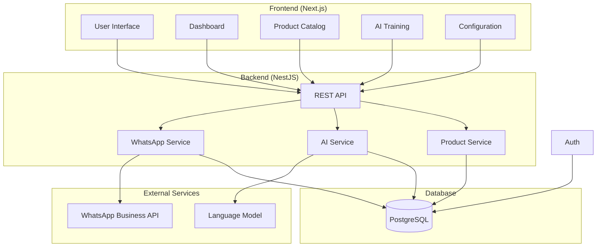

# Design Document

## Overview

The WhatsApp Automated Messaging System is a full-stack application that integrates WhatsApp Business API with AI-powered conversation handling. The system uses NestJS for the backend API, Next.js/React with Tailwind CSS and shadcn/ui for the frontend, Drizzle ORM with PostgreSQL for data persistence, and LangChain for AI conversation management.

The architecture follows a microservices-inspired approach with clear separation of concerns: WhatsApp integration, AI processing, product catalog management, and user interface components.

## Architecture

### High-Level Architecture



### Technology Stack Integration

- **Frontend**: Next.js 14 with App Router, React 18, TypeScript, Tailwind CSS, shadcn/ui components
- **Backend**: NestJS with TypeScript, class-validator, class-transformer
- **Database**: PostgreSQL with Drizzle ORM for type-safe database operations
- **AI**: LangChain for conversation management, OpenAI/Anthropic for language models
- **WhatsApp**: WhatsApp Business API with webhook integration

- **File Storage**: Local storage or cloud storage (AWS S3/Cloudinary) for product images

## Components and Interfaces

### Backend Services

#### WhatsApp Service
```typescript
interface WhatsAppService {
  connectAccount(credentials: WhatsAppCredentials): Promise<ConnectionResult>
  sendMessage(phoneNumber: string, message: string): Promise<MessageResult>
  receiveWebhook(payload: WhatsAppWebhook): Promise<void>
  verifyWebhook(token: string): boolean
  disconnectAccount(): Promise<void>
}

interface WhatsAppCredentials {
  phoneNumberId: string
  accessToken: string
  webhookVerifyToken: string
}
```

#### AI Service
```typescript
interface AIService {
  processMessage(message: IncomingMessage, context: ConversationContext): Promise<AIResponse>
  trainModel(examples: ConversationExample[]): Promise<TrainingResult>
  updateProductKnowledge(products: Product[]): Promise<void>
  setConversationGoal(goal: ConversationGoal): Promise<void>
}

interface ConversationContext {
  customerPhone: string
  conversationHistory: Message[]
  products: Product[]
  conversationGoal: ConversationGoal
  businessHours: BusinessHours
}
```

#### Product Service
```typescript
interface ProductService {
  createProduct(product: CreateProductDto): Promise<Product>
  updateProduct(id: string, updates: UpdateProductDto): Promise<Product>
  deleteProduct(id: string): Promise<void>
  searchProducts(query: string): Promise<Product[]>
  uploadProductImage(productId: string, file: Express.Multer.File): Promise<string>
}
```

### Frontend Components

#### Dashboard Components
- **ConversationMetrics**: Real-time conversation statistics
- **RecentInteractions**: List of recent customer interactions
- **PerformanceCharts**: AI response accuracy and response time metrics

#### Product Catalog Components
- **ProductGrid**: Display products in a responsive grid
- **ProductForm**: Add/edit product information
- **ImageUpload**: Handle product image uploads with preview
- **ProductSearch**: Real-time search and filtering

#### AI Training Components
- **ConversationExamples**: Manage training conversation pairs
- **GoalSelector**: Choose conversation goals and behavior
- **TrainingProgress**: Show model training status
- **ResponsePreview**: Test AI responses with sample inputs

## Data Models

### Core Entities

```typescript
// WhatsApp Account Management (Single Account MVP)
interface WhatsAppAccount {
  id: string
  phoneNumberId: string
  accessToken: string // encrypted
  webhookVerifyToken: string // encrypted
  isConnected: boolean
  businessName: string
  phoneNumber: string
  createdAt: Date
  updatedAt: Date
}

// Product Catalog
interface Product {
  id: string
  name: string
  description: string
  price: number
  currency: string
  images: string[]
  category?: string
  inStock: boolean
  createdAt: Date
  updatedAt: Date
}

// Conversation Management
interface Conversation {
  id: string
  customerPhone: string
  customerName?: string
  status: 'active' | 'resolved' | 'escalated'
  createdAt: Date
  updatedAt: Date
  messages: Message[]
}

interface Message {
  id: string
  conversationId: string
  content: string
  type: 'incoming' | 'outgoing'
  isAI: boolean
  confidence?: number
  timestamp: Date
  metadata?: Record<string, any>
}

// AI Training and Configuration
interface ConversationExample {
  id: string
  customerMessage: string
  desiredResponse: string
  category?: string
  createdAt: Date
}

interface AIConfiguration {
  id: string
  conversationGoal: ConversationGoal
  confidenceThreshold: number
  responseStyle: string
  fallbackMessage: string
  businessHours: BusinessHours
  enableManualReview: boolean
  createdAt: Date
  updatedAt: Date
}

type ConversationGoal = 'helpful' | 'deal_closer' | 'support_agent' | 'lead_generator' | 'custom'

interface BusinessHours {
  timezone: string
  schedule: {
    [key: string]: { start: string; end: string; active: boolean }
  }
}
```

### Database Schema (Drizzle)

```typescript
// Database tables using Drizzle schema (MVP - Single Account)
export const whatsappAccounts = pgTable('whatsapp_accounts', {
  id: uuid('id').defaultRandom().primaryKey(),
  phoneNumberId: varchar('phone_number_id', { length: 255 }).notNull(),
  accessToken: text('access_token').notNull(), // encrypted
  webhookVerifyToken: varchar('webhook_verify_token', { length: 255 }).notNull(),
  isConnected: boolean('is_connected').default(false),
  businessName: varchar('business_name', { length: 255 }),
  phoneNumber: varchar('phone_number', { length: 50 }),
  createdAt: timestamp('created_at').defaultNow(),
  updatedAt: timestamp('updated_at').defaultNow()
})

export const products = pgTable('products', {
  id: uuid('id').defaultRandom().primaryKey(),
  name: varchar('name', { length: 255 }).notNull(),
  description: text('description'),
  price: decimal('price', { precision: 10, scale: 2 }).notNull(),
  currency: varchar('currency', { length: 3 }).default('USD'),
  images: json('images').$type<string[]>().default([]),
  category: varchar('category', { length: 100 }),
  inStock: boolean('in_stock').default(true),
  createdAt: timestamp('created_at').defaultNow(),
  updatedAt: timestamp('updated_at').defaultNow()
})

export const conversations = pgTable('conversations', {
  id: uuid('id').defaultRandom().primaryKey(),
  customerPhone: varchar('customer_phone', { length: 50 }).notNull(),
  customerName: varchar('customer_name', { length: 255 }),
  status: varchar('status', { length: 20 }).default('active'),
  createdAt: timestamp('created_at').defaultNow(),
  updatedAt: timestamp('updated_at').defaultNow()
})

export const conversationExamples = pgTable('conversation_examples', {
  id: uuid('id').defaultRandom().primaryKey(),
  customerMessage: text('customer_message').notNull(),
  desiredResponse: text('desired_response').notNull(),
  category: varchar('category', { length: 100 }),
  createdAt: timestamp('created_at').defaultNow()
})

export const aiConfiguration = pgTable('ai_configuration', {
  id: uuid('id').defaultRandom().primaryKey(),
  conversationGoal: varchar('conversation_goal', { length: 50 }).default('helpful'),
  confidenceThreshold: decimal('confidence_threshold', { precision: 3, scale: 2 }).default('0.80'),
  responseStyle: text('response_style'),
  fallbackMessage: text('fallback_message'),
  businessHours: json('business_hours'),
  enableManualReview: boolean('enable_manual_review').default(false),
  createdAt: timestamp('created_at').defaultNow(),
  updatedAt: timestamp('updated_at').defaultNow()
})
```

## Error Handling

### Backend Error Strategy

1. **Global Exception Filter**: Catch and format all unhandled exceptions
2. **Custom Exception Classes**: Business logic specific exceptions
3. **Validation Pipes**: Input validation with detailed error messages
4. **Logging**: Structured logging with correlation IDs for request tracking

```typescript
// Custom exceptions
export class WhatsAppConnectionError extends HttpException {
  constructor(message: string) {
    super(`WhatsApp connection failed: ${message}`, HttpStatus.BAD_REQUEST)
  }
}

export class AIProcessingError extends HttpException {
  constructor(message: string) {
    super(`AI processing failed: ${message}`, HttpStatus.INTERNAL_SERVER_ERROR)
  }
}

// Global exception filter
@Catch()
export class GlobalExceptionFilter implements ExceptionFilter {
  catch(exception: unknown, host: ArgumentsHost) {
    const ctx = host.switchToHttp()
    const response = ctx.getResponse()
    const request = ctx.getRequest()
    
    const status = exception instanceof HttpException 
      ? exception.getStatus() 
      : HttpStatus.INTERNAL_SERVER_ERROR
    
    const errorResponse = {
      statusCode: status,
      timestamp: new Date().toISOString(),
      path: request.url,
      message: exception instanceof HttpException 
        ? exception.message 
        : 'Internal server error'
    }
    
    response.status(status).json(errorResponse)
  }
}
```

### Frontend Error Handling

1. **Error Boundaries**: React error boundaries for component-level error handling
2. **API Error Interceptors**: Centralized API error handling with user-friendly messages
3. **Toast Notifications**: User feedback for errors and success states
4. **Retry Logic**: Automatic retry for transient failures

## Testing Strategy

### Backend Testing

1. **Unit Tests**: Service layer testing with mocked dependencies
2. **Integration Tests**: API endpoint testing with test database
3. **E2E Tests**: Full workflow testing including WhatsApp webhook simulation

```typescript
// Example service test
describe('AIService', () => {
  let service: AIService
  let mockLangChain: jest.Mocked<LangChainService>
  
  beforeEach(async () => {
    const module = await Test.createTestingModule({
      providers: [
        AIService,
        { provide: LangChainService, useValue: mockLangChain }
      ]
    }).compile()
    
    service = module.get<AIService>(AIService)
  })
  
  it('should process message and return AI response', async () => {
    const message = { content: 'Hello', customerPhone: '+1234567890' }
    const context = { userId: 'user1', products: [], conversationGoal: 'helpful' }
    
    mockLangChain.generateResponse.mockResolvedValue({
      content: 'Hello! How can I help you today?',
      confidence: 0.95
    })
    
    const result = await service.processMessage(message, context)
    
    expect(result.content).toBe('Hello! How can I help you today?')
    expect(result.confidence).toBe(0.95)
  })
})
```

### Frontend Testing

1. **Component Tests**: React Testing Library for component behavior
2. **Integration Tests**: User interaction flows
3. **Visual Regression Tests**: Screenshot comparison for UI consistency

```typescript
// Example component test
describe('ProductForm', () => {
  it('should submit product data when form is valid', async () => {
    const mockOnSubmit = jest.fn()
    render(<ProductForm onSubmit={mockOnSubmit} />)
    
    await user.type(screen.getByLabelText(/product name/i), 'Test Product')
    await user.type(screen.getByLabelText(/description/i), 'Test Description')
    await user.type(screen.getByLabelText(/price/i), '29.99')
    
    await user.click(screen.getByRole('button', { name: /save product/i }))
    
    expect(mockOnSubmit).toHaveBeenCalledWith({
      name: 'Test Product',
      description: 'Test Description',
      price: 29.99
    })
  })
})
```

### AI Testing Strategy

1. **Response Quality Tests**: Validate AI responses against expected patterns
2. **Conversation Flow Tests**: Test multi-turn conversation handling
3. **Goal-based Testing**: Verify different conversation goals produce appropriate responses
4. **Performance Tests**: Response time and accuracy metrics