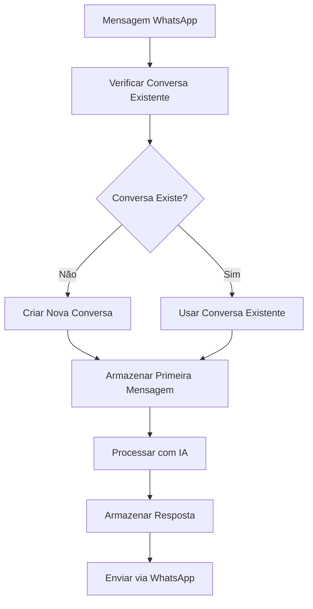
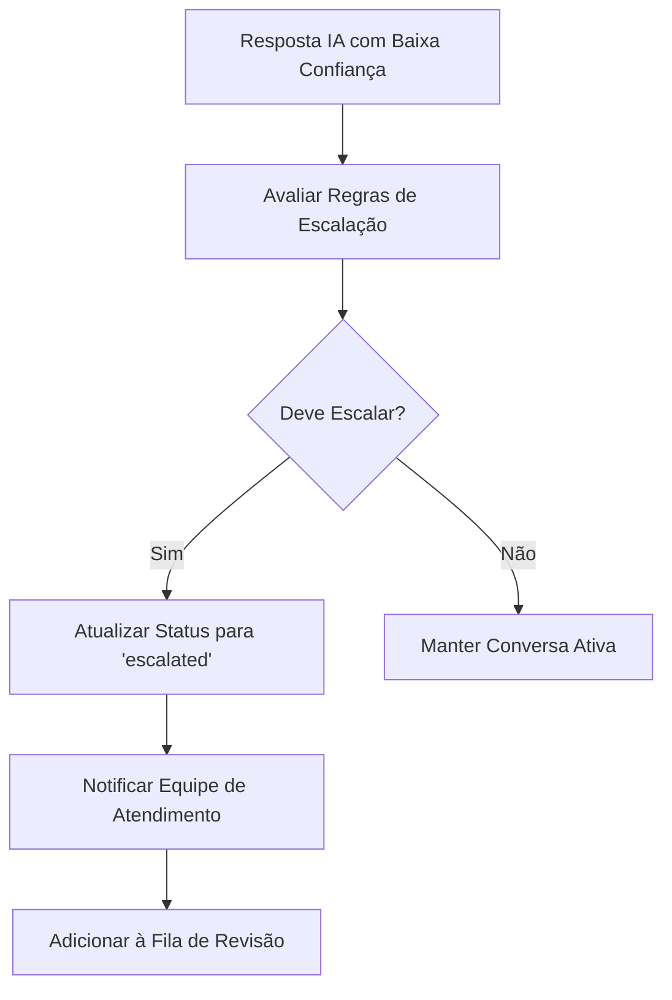
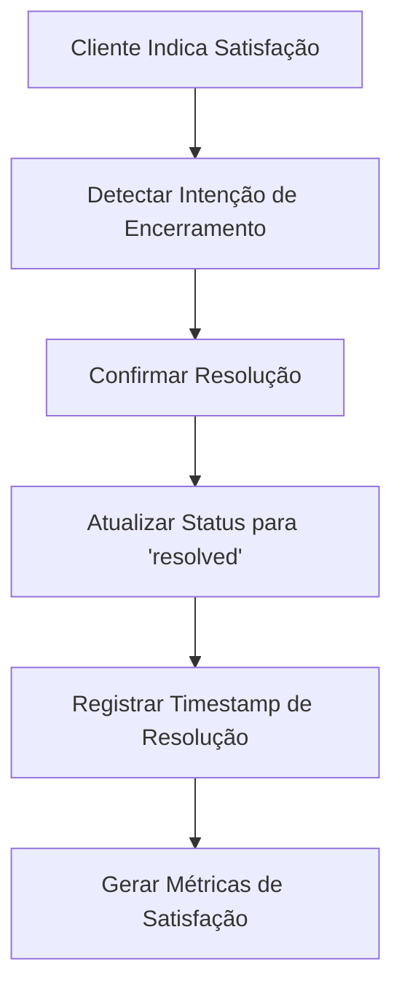

# Conversations Module - Módulo de Conversas

O Conversations Module gerencia todo o ciclo de vida das conversas entre clientes e a plataforma, incluindo histórico de mensagens, status de conversas e integração com o sistema de IA.

## 📁 Estrutura do Módulo

```
src/conversations/
├── controllers/
│   └── conversation.controller.ts        # Controller REST para conversas
├── dto/
│   ├── conversation-query.dto.ts         # DTO para consultas
│   ├── create-conversation.dto.ts        # DTO para criação
│   ├── create-message.dto.ts             # DTO para mensagens
│   └── update-conversation.dto.ts        # DTO para atualizações
├── services/
│   └── conversation.service.ts           # Serviço principal
└── conversations.module.ts               # Módulo NestJS
```

## 🎯 Principais Funcionalidades

### 1. Gerenciamento de Conversas
- **Criação Automática**: Conversas criadas automaticamente no primeiro contato
- **Status Tracking**: Acompanha status (ativa, resolvida, escalada)
- **Metadados**: Armazena informações contextuais da conversa
- **Busca e Filtros**: Sistema avançado de busca e filtros

### 2. Histórico de Mensagens
- **Armazenamento Completo**: Todas as mensagens são persistidas
- **Tipos de Mensagem**: Diferencia mensagens recebidas, enviadas e de IA
- **Timestamps**: Registro preciso de horários
- **Pontuação de Confiança**: Armazena confiança das respostas de IA

### 3. Sistema de Status
- **Active**: Conversa em andamento
- **Resolved**: Conversa finalizada com sucesso
- **Escalated**: Conversa transferida para atendimento humano
- **Pending**: Aguardando resposta do cliente

### 4. Integração com IA
- **Contexto Automático**: Fornece contexto para o sistema de IA
- **Histórico Inteligente**: Mantém histórico relevante para IA
- **Escalação Automática**: Integra com sistema de escalação

## 🔧 APIs Principais

### Conversation Controller

#### Listar Conversas
```typescript
GET /conversations?status=active&limit=20&page=1

// Resposta
{
  "conversations": [
    {
      "id": "uuid",
      "customerPhone": "+5511999999999",
      "customerName": "João Silva",
      "status": "active",
      "createdAt": "2024-01-15T10:30:00Z",
      "updatedAt": "2024-01-15T11:45:00Z",
      "messages": [...]
    }
  ],
  "total": 150,
  "page": 1,
  "limit": 20,
  "totalPages": 8
}
```

#### Criar Conversa
```typescript
POST /conversations
{
  "customerPhone": "+5511999999999",
  "customerName": "João Silva",
  "initialMessage": "Olá, preciso de ajuda"
}

// Resposta
{
  "id": "uuid",
  "customerPhone": "+5511999999999",
  "customerName": "João Silva",
  "status": "active",
  "createdAt": "2024-01-15T10:30:00Z"
}
```

#### Buscar Conversa por ID
```typescript
GET /conversations/:id

// Resposta
{
  "id": "uuid",
  "customerPhone": "+5511999999999",
  "customerName": "João Silva",
  "status": "active",
  "createdAt": "2024-01-15T10:30:00Z",
  "updatedAt": "2024-01-15T11:45:00Z",
  "messages": [
    {
      "id": "msg-uuid",
      "content": "Olá, preciso de ajuda",
      "type": "incoming",
      "isAI": false,
      "timestamp": "2024-01-15T10:30:00Z"
    },
    {
      "id": "msg-uuid-2",
      "content": "Olá! Como posso ajudá-lo hoje?",
      "type": "outgoing",
      "isAI": true,
      "confidence": 95,
      "timestamp": "2024-01-15T10:30:15Z"
    }
  ]
}
```

#### Buscar por Telefone
```typescript
GET /conversations/phone/:phoneNumber

// Resposta - mesma estrutura da busca por ID
```

#### Adicionar Mensagem
```typescript
POST /conversations/:id/messages
{
  "content": "Obrigado pela ajuda!",
  "type": "incoming",
  "isAI": false
}

// Resposta
{
  "id": "msg-uuid",
  "conversationId": "conv-uuid",
  "content": "Obrigado pela ajuda!",
  "type": "incoming",
  "isAI": false,
  "timestamp": "2024-01-15T11:45:00Z"
}
```

#### Atualizar Conversa
```typescript
PUT /conversations/:id
{
  "status": "resolved",
  "customerName": "João Silva Santos"
}
```

#### Escalar Conversa
```typescript
POST /conversations/:id/escalate

// Resposta
{
  "id": "uuid",
  "status": "escalated",
  "escalatedAt": "2024-01-15T12:00:00Z"
}
```

#### Resolver Conversa
```typescript
POST /conversations/:id/resolve

// Resposta
{
  "id": "uuid",
  "status": "resolved",
  "resolvedAt": "2024-01-15T12:00:00Z"
}
```

#### Conversas Precisando de Atenção
```typescript
GET /conversations/needs-attention

// Retorna conversas escaladas ou com baixa confiança
{
  "conversations": [
    {
      "id": "uuid",
      "customerPhone": "+5511999999999",
      "status": "escalated",
      "lastMessage": {
        "content": "Não estou satisfeito com o produto",
        "confidence": 25,
        "timestamp": "2024-01-15T11:30:00Z"
      },
      "escalationReason": "Low confidence response"
    }
  ]
}
```

#### Histórico de Mensagens
```typescript
GET /conversations/:id/history?limit=50

// Resposta
{
  "messages": [
    {
      "id": "msg-uuid",
      "content": "Olá, preciso de ajuda",
      "type": "incoming",
      "isAI": false,
      "timestamp": "2024-01-15T10:30:00Z"
    }
  ],
  "total": 25,
  "hasMore": false
}
```

## 📊 DTOs e Validações

### ConversationQueryDto
```typescript
export class ConversationQueryDto {
  @IsOptional()
  @IsIn(['active', 'resolved', 'escalated', 'pending'])
  status?: string;

  @IsOptional()
  @IsString()
  customerPhone?: string;

  @IsOptional()
  @IsString()
  customerName?: string;

  @IsOptional()
  @IsDateString()
  startDate?: string;

  @IsOptional()
  @IsDateString()
  endDate?: string;

  @IsOptional()
  @IsInt()
  @Min(1)
  @Max(100)
  limit?: number = 20;

  @IsOptional()
  @IsInt()
  @Min(1)
  page?: number = 1;

  @IsOptional()
  @IsString()
  search?: string;
}
```

### CreateConversationDto
```typescript
export class CreateConversationDto {
  @IsString()
  @IsNotEmpty()
  @Matches(/^\+[1-9]\d{1,14}$/, {
    message: 'Número de telefone deve estar no formato internacional'
  })
  customerPhone: string;

  @IsOptional()
  @IsString()
  @MaxLength(100)
  customerName?: string;

  @IsOptional()
  @IsString()
  @MaxLength(1000)
  initialMessage?: string;

  @IsOptional()
  @IsObject()
  metadata?: Record<string, any>;
}
```

### CreateMessageDto
```typescript
export class CreateMessageDto {
  @IsString()
  @IsNotEmpty()
  @MaxLength(4000)
  content: string;

  @IsIn(['incoming', 'outgoing'])
  type: 'incoming' | 'outgoing';

  @IsBoolean()
  @IsOptional()
  isAI?: boolean = false;

  @IsOptional()
  @IsNumber()
  @Min(0)
  @Max(100)
  confidence?: number;

  @IsOptional()
  @IsObject()
  metadata?: Record<string, any>;
}
```

### UpdateConversationDto
```typescript
export class UpdateConversationDto {
  @IsOptional()
  @IsString()
  @MaxLength(100)
  customerName?: string;

  @IsOptional()
  @IsIn(['active', 'resolved', 'escalated', 'pending'])
  status?: string;

  @IsOptional()
  @IsObject()
  metadata?: Record<string, any>;
}
```

## 🗄️ Estrutura do Banco de Dados

### Tabela Conversations
```sql
CREATE TABLE conversations (
  id UUID PRIMARY KEY DEFAULT gen_random_uuid(),
  customer_phone VARCHAR(20) NOT NULL,
  customer_name VARCHAR(100),
  status VARCHAR(20) DEFAULT 'active',
  created_at TIMESTAMP DEFAULT NOW(),
  updated_at TIMESTAMP DEFAULT NOW(),
  resolved_at TIMESTAMP,
  escalated_at TIMESTAMP,
  metadata JSONB,
  
  INDEX idx_conversations_phone (customer_phone),
  INDEX idx_conversations_status (status),
  INDEX idx_conversations_created_at (created_at)
);
```

### Tabela Messages
```sql
CREATE TABLE messages (
  id UUID PRIMARY KEY DEFAULT gen_random_uuid(),
  conversation_id UUID REFERENCES conversations(id) ON DELETE CASCADE,
  content TEXT NOT NULL,
  type VARCHAR(20) NOT NULL, -- 'incoming' | 'outgoing'
  is_ai BOOLEAN DEFAULT FALSE,
  confidence INTEGER, -- 0-100
  timestamp TIMESTAMP DEFAULT NOW(),
  metadata JSONB,
  
  INDEX idx_messages_conversation_id (conversation_id),
  INDEX idx_messages_timestamp (timestamp),
  INDEX idx_messages_type (type)
);
```

## 🔄 Fluxos de Trabalho

### 1. Fluxo de Nova Conversa


### 2. Fluxo de Escalação


### 3. Fluxo de Resolução


## 📈 Métricas e Analytics

### Métricas de Conversa
```typescript
interface ConversationMetrics {
  totalConversations: number;
  activeConversations: number;
  resolvedConversations: number;
  escalatedConversations: number;
  averageResolutionTime: number; // em minutos
  averageMessagesPerConversation: number;
  customerSatisfactionRate: number; // 0-100
}
```

### Métricas por Período
```typescript
// Obter métricas dos últimos 30 dias
GET /conversations/metrics?period=30d

{
  "period": "30d",
  "totalConversations": 1250,
  "newConversations": 320,
  "resolvedConversations": 280,
  "escalatedConversations": 45,
  "averageResolutionTime": 25.5,
  "topCustomerIssues": [
    { "issue": "product_inquiry", "count": 150 },
    { "issue": "support_request", "count": 95 }
  ],
  "hourlyDistribution": {
    "09": 45,
    "10": 67,
    "11": 89
  }
}
```

## 🔍 Exemplos de Uso

### Busca Avançada de Conversas
```typescript
// Buscar conversas escaladas nos últimos 7 dias
const escalatedConversations = await conversationService.findConversations({
  status: 'escalated',
  startDate: '2024-01-08T00:00:00Z',
  endDate: '2024-01-15T23:59:59Z',
  limit: 50,
  page: 1
});

// Buscar conversas de um cliente específico
const customerConversations = await conversationService.findConversations({
  customerPhone: '+5511999999999',
  limit: 10
});

// Buscar conversas por palavra-chave
const searchResults = await conversationService.findConversations({
  search: 'produto defeituoso',
  status: 'active'
});
```

### Análise de Padrões
```typescript
// Identificar conversas com baixa confiança
const lowConfidenceConversations = await conversationService.findConversations({
  status: 'active'
});

const filtered = lowConfidenceConversations.conversations.filter(conv => {
  const lastMessage = conv.messages[conv.messages.length - 1];
  return lastMessage.isAI && lastMessage.confidence < 60;
});

// Análise de tempo de resposta
const responseTimeAnalysis = conversations.map(conv => {
  const messages = conv.messages.sort((a, b) => 
    new Date(a.timestamp).getTime() - new Date(b.timestamp).getTime()
  );
  
  const responseTimes = [];
  for (let i = 1; i < messages.length; i++) {
    if (messages[i-1].type === 'incoming' && messages[i].type === 'outgoing') {
      const responseTime = new Date(messages[i].timestamp).getTime() - 
                          new Date(messages[i-1].timestamp).getTime();
      responseTimes.push(responseTime / 1000); // em segundos
    }
  }
  
  return {
    conversationId: conv.id,
    averageResponseTime: responseTimes.reduce((a, b) => a + b, 0) / responseTimes.length
  };
});
```

### Integração com Sistema de IA
```typescript
// Obter contexto para processamento de IA
const conversationContext = await conversationService.getConversationContext(
  conversationId
);

// Estrutura do contexto
interface ConversationContext {
  conversation: Conversation;
  recentMessages: Message[]; // últimas 10 mensagens
  customerProfile: {
    phone: string;
    name?: string;
    previousConversations: number;
    averageResponseTime: number;
    preferredTopics: string[];
  };
  aiMetrics: {
    averageConfidence: number;
    escalationCount: number;
    successfulResolutions: number;
  };
}
```

## 🚀 Melhores Práticas

### 1. Performance
- **Paginação**: Sempre use paginação para listas grandes
- **Índices**: Mantenha índices otimizados para consultas frequentes
- **Cache**: Cache conversas ativas em memória
- **Limpeza**: Implemente rotinas de limpeza para dados antigos

### 2. Escalação Inteligente
- **Regras Claras**: Defina regras claras de escalação
- **Priorização**: Implemente sistema de prioridades
- **Notificações**: Configure alertas para escalações críticas
- **SLA**: Monitore tempos de resposta

### 3. Análise de Dados
- **Métricas Contínuas**: Colete métricas em tempo real
- **Dashboards**: Crie dashboards para visualização
- **Alertas**: Configure alertas para anomalias
- **Relatórios**: Gere relatórios periódicos

### 4. Integração
- **APIs Consistentes**: Mantenha APIs consistentes
- **Versionamento**: Implemente versionamento de APIs
- **Documentação**: Mantenha documentação atualizada
- **Testes**: Implemente testes abrangentes

## 🔧 Troubleshooting

### Problemas Comuns

#### Conversas Duplicadas
```typescript
// Verificar duplicatas por telefone
const duplicates = await db.select()
  .from(conversations)
  .where(eq(conversations.customerPhone, phone))
  .orderBy(desc(conversations.createdAt));

if (duplicates.length > 1) {
  // Consolidar conversas
  await consolidateConversations(duplicates);
}
```

#### Performance Lenta
```typescript
// Otimizar consultas com índices
CREATE INDEX CONCURRENTLY idx_conversations_phone_status 
ON conversations (customer_phone, status);

CREATE INDEX CONCURRENTLY idx_messages_conversation_timestamp 
ON messages (conversation_id, timestamp DESC);
```

#### Mensagens Perdidas
```typescript
// Verificar integridade de mensagens
const orphanedMessages = await db.select()
  .from(messages)
  .leftJoin(conversations, eq(messages.conversationId, conversations.id))
  .where(isNull(conversations.id));

if (orphanedMessages.length > 0) {
  console.warn('Mensagens órfãs encontradas:', orphanedMessages.length);
}
```

O Conversations Module é essencial para manter o histórico e contexto das interações, fornecendo a base para um atendimento inteligente e personalizado.