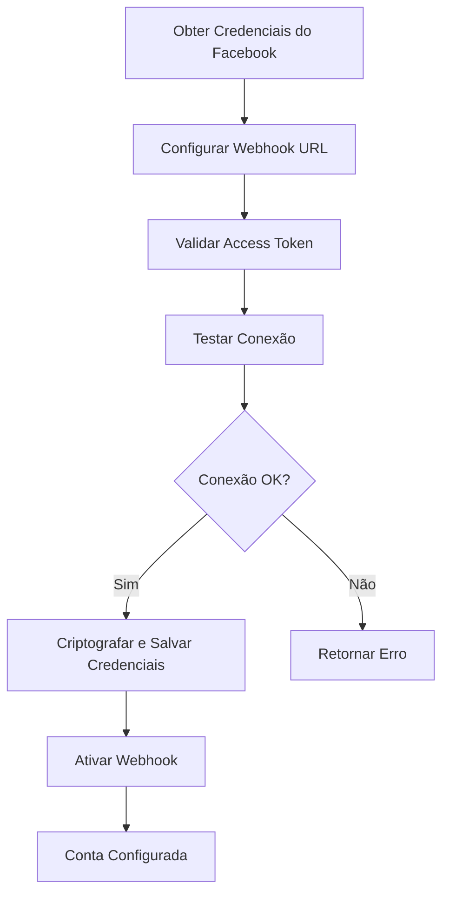
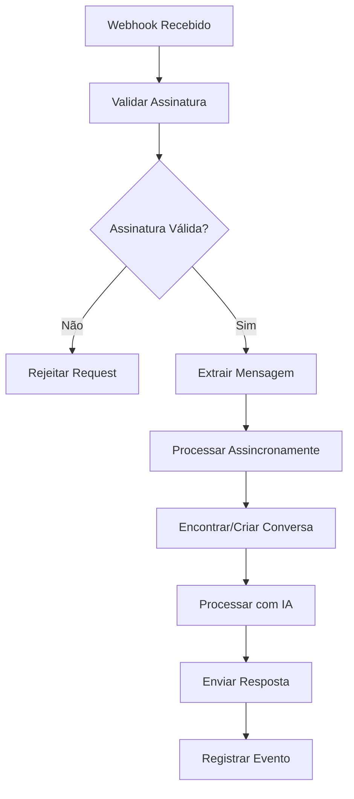
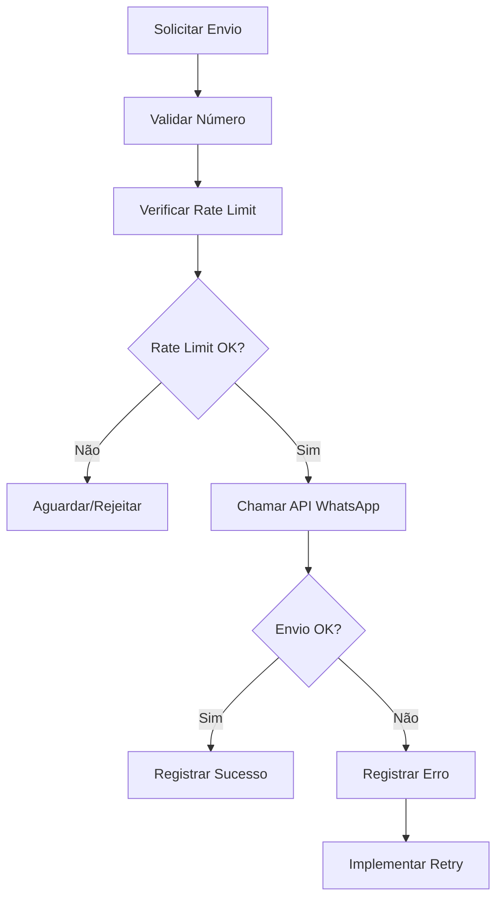

# WhatsApp Module - Módulo de Integração WhatsApp

O WhatsApp Module é responsável pela integração completa com a WhatsApp Business API, gerenciando webhooks, envio/recebimento de mensagens e autenticação segura.

## 📁 Estrutura do Módulo

```
src/whatsapp/
├── controllers/
│   └── webhook.controller.ts             # Controller para webhooks
├── dto/
│   └── whatsapp-credentials.dto.ts       # DTOs para credenciais
├── exceptions/
│   └── whatsapp.exceptions.ts            # Exceções personalizadas
├── interfaces/
│   └── whatsapp.interface.ts             # Interfaces TypeScript
├── services/
│   ├── encryption.service.ts             # Criptografia de credenciais
│   ├── message-processor.service.ts      # Processamento de mensagens
│   └── whatsapp.service.ts               # Serviço principal
└── whatsapp.module.ts                    # Módulo NestJS
```

## 🎯 Principais Funcionalidades

### 1. Integração com WhatsApp Business API
- **Conexão Segura**: Autenticação via Access Token
- **Webhook Handling**: Recebimento de mensagens em tempo real
- **Envio de Mensagens**: API para envio de respostas
- **Validação de Webhook**: Verificação de segurança do Facebook

### 2. Gerenciamento de Credenciais
- **Criptografia**: Credenciais criptografadas no banco de dados
- **Múltiplas Contas**: Suporte a múltiplas contas WhatsApp Business
- **Rotação de Tokens**: Sistema para renovação de tokens
- **Validação**: Verificação automática de credenciais

### 3. Processamento de Mensagens
- **Parsing Inteligente**: Extração de dados das mensagens
- **Detecção de Tipo**: Suporte a texto, imagem, áudio, etc.
- **Contexto de Conversa**: Manutenção do contexto da conversa
- **Rate Limiting**: Controle de taxa de envio

### 4. Sistema de Webhook
- **Verificação de Segurança**: Validação de assinatura do Facebook
- **Processamento Assíncrono**: Handling não-bloqueante de webhooks
- **Retry Logic**: Reenvio automático em caso de falha
- **Logging Detalhado**: Rastreamento completo de eventos

## 🔧 APIs Principais

### Webhook Controller

#### Verificação de Webhook
```typescript
GET /whatsapp/webhook?hub.mode=subscribe&hub.verify_token=TOKEN&hub.challenge=CHALLENGE

// Resposta: retorna o challenge se o token for válido
```

#### Recebimento de Mensagens
```typescript
POST /whatsapp/webhook
{
  "object": "whatsapp_business_account",
  "entry": [
    {
      "id": "WHATSAPP_BUSINESS_ACCOUNT_ID",
      "changes": [
        {
          "value": {
            "messaging_product": "whatsapp",
            "metadata": {
              "display_phone_number": "15550559999",
              "phone_number_id": "PHONE_NUMBER_ID"
            },
            "contacts": [
              {
                "profile": {
                  "name": "João Silva"
                },
                "wa_id": "5511999999999"
              }
            ],
            "messages": [
              {
                "from": "5511999999999",
                "id": "wamid.ID",
                "timestamp": "1234567890",
                "text": {
                  "body": "Olá, preciso de ajuda"
                },
                "type": "text"
              }
            ]
          },
          "field": "messages"
        }
      ]
    }
  ]
}
```

#### Health Check
```typescript
GET /whatsapp/webhook/health

// Resposta
{
  "status": "ok",
  "timestamp": "2024-01-15T10:30:00Z",
  "webhookActive": true
}
```

### WhatsApp Service

#### Conectar Conta
```typescript
POST /whatsapp/connect
{
  "phoneNumberId": "PHONE_NUMBER_ID",
  "accessToken": "ACCESS_TOKEN",
  "webhookVerifyToken": "WEBHOOK_VERIFY_TOKEN",
  "businessName": "Minha Empresa",
  "phoneNumber": "+5511999999999"
}

// Resposta
{
  "success": true,
  "message": "Conta conectada com sucesso",
  "accountInfo": {
    "phoneNumberId": "PHONE_NUMBER_ID",
    "businessName": "Minha Empresa",
    "phoneNumber": "+5511999999999"
  }
}
```

#### Enviar Mensagem
```typescript
POST /whatsapp/send
{
  "phoneNumber": "+5511999999999",
  "message": "Olá! Como posso ajudá-lo hoje?"
}

// Resposta
{
  "success": true,
  "messageId": "wamid.MESSAGE_ID"
}
```

#### Status da Conexão
```typescript
GET /whatsapp/status

// Resposta
{
  "connected": true,
  "accountInfo": {
    "phoneNumberId": "PHONE_NUMBER_ID",
    "businessName": "Minha Empresa",
    "phoneNumber": "+5511999999999",
    "lastActivity": "2024-01-15T10:30:00Z"
  },
  "webhookStatus": "active",
  "apiStatus": "healthy"
}
```

#### Desconectar Conta
```typescript
POST /whatsapp/disconnect

// Resposta
{
  "success": true,
  "message": "Conta desconectada com sucesso"
}
```

## 🔐 Sistema de Criptografia

### Encryption Service

```typescript
export class EncryptionService {
  private readonly algorithm = 'aes-256-gcm';
  private readonly secretKey: string;

  constructor() {
    this.secretKey = this.configService.get<string>('ENCRYPTION_KEY');
  }

  encrypt(text: string): string {
    const iv = crypto.randomBytes(16);
    const cipher = crypto.createCipher(this.algorithm, this.secretKey);
    cipher.setAAD(Buffer.from('whatsapp-credentials'));
    
    let encrypted = cipher.update(text, 'utf8', 'hex');
    encrypted += cipher.final('hex');
    
    const authTag = cipher.getAuthTag();
    
    return `${iv.toString('hex')}:${authTag.toString('hex')}:${encrypted}`;
  }

  decrypt(encryptedText: string): string {
    const [ivHex, authTagHex, encrypted] = encryptedText.split(':');
    
    const iv = Buffer.from(ivHex, 'hex');
    const authTag = Buffer.from(authTagHex, 'hex');
    
    const decipher = crypto.createDecipher(this.algorithm, this.secretKey);
    decipher.setAAD(Buffer.from('whatsapp-credentials'));
    decipher.setAuthTag(authTag);
    
    let decrypted = decipher.update(encrypted, 'hex', 'utf8');
    decrypted += decipher.final('utf8');
    
    return decrypted;
  }

  isEncrypted(text: string): boolean {
    return text.includes(':') && text.split(':').length === 3;
  }
}
```

## 📨 Processamento de Mensagens

### Message Processor Service

```typescript
export class MessageProcessorService {
  async processIncomingMessage(incomingMessage: IncomingMessage): Promise<ProcessedMessage> {
    // 1. Encontrar ou criar conversa
    const conversation = await this.findOrCreateConversation(
      incomingMessage.from,
      incomingMessage.customerName
    );

    // 2. Armazenar mensagem recebida
    const messageId = await this.storeMessage(conversation.id, incomingMessage);

    // 3. Verificar se deve responder
    const shouldRespond = await this.shouldRespondToMessage(
      conversation.id,
      incomingMessage
    );

    if (!shouldRespond) {
      return {
        conversationId: conversation.id,
        messageId,
        shouldRespond: false
      };
    }

    // 4. Obter contexto da conversa
    const context = await this.getConversationContext(conversation.id);

    // 5. Processar com IA
    const aiResponse = await this.aiService.processMessage(incomingMessage, context);

    // 6. Verificar se deve escalar
    if (aiResponse.shouldEscalate) {
      await this.markConversationAsEscalated(conversation.id);
      return {
        conversationId: conversation.id,
        messageId,
        shouldRespond: false,
        escalated: true
      };
    }

    // 7. Enviar resposta
    const sendResult = await this.whatsappService.sendMessage(
      incomingMessage.from,
      aiResponse.content
    );

    // 8. Armazenar resposta enviada
    if (sendResult.success) {
      await this.storeOutgoingMessage(
        conversation.id,
        aiResponse.content,
        true,
        aiResponse.confidence
      );
    }

    return {
      conversationId: conversation.id,
      messageId,
      shouldRespond: true,
      aiResponse,
      sendResult
    };
  }
}
```

## 🔍 Interfaces e DTOs

### WhatsApp Interfaces

```typescript
interface WhatsAppCredentials {
  phoneNumberId: string;
  accessToken: string;
  webhookVerifyToken: string;
  businessName?: string;
  phoneNumber?: string;
}

interface IncomingMessage {
  messageId: string;
  from: string;
  content: string;
  timestamp: Date;
  customerName?: string;
  messageType?: 'text' | 'image' | 'audio' | 'document';
  metadata?: Record<string, any>;
}

interface MessageResult {
  success: boolean;
  messageId?: string;
  error?: string;
  rateLimited?: boolean;
  retryAfter?: number;
}

interface ConnectionResult {
  success: boolean;
  message: string;
  accountInfo?: {
    phoneNumberId: string;
    businessName?: string;
    phoneNumber?: string;
    verified: boolean;
  };
  error?: string;
}
```

### DTOs de Validação

```typescript
export class WhatsAppCredentialsDto {
  @IsString()
  @IsNotEmpty()
  phoneNumberId: string;

  @IsString()
  @IsNotEmpty()
  @MinLength(50)
  accessToken: string;

  @IsString()
  @IsNotEmpty()
  @MinLength(10)
  webhookVerifyToken: string;

  @IsOptional()
  @IsString()
  @MaxLength(100)
  businessName?: string;

  @IsOptional()
  @IsString()
  @Matches(/^\+[1-9]\d{1,14}$/)
  phoneNumber?: string;
}

export class ConnectionResultDto {
  @IsBoolean()
  success: boolean;

  @IsString()
  message: string;

  @IsOptional()
  @IsObject()
  accountInfo?: {
    phoneNumberId: string;
    businessName?: string;
    phoneNumber?: string;
  };
}
```

## 🚨 Tratamento de Exceções

### WhatsApp Exceptions

```typescript
export class WhatsAppConnectionError extends HttpException {
  constructor(message: string, statusCode: number = HttpStatus.BAD_GATEWAY) {
    super({
      error: 'WhatsApp Connection Error',
      message,
      statusCode,
      timestamp: new Date().toISOString()
    }, statusCode);
  }
}

export class WhatsAppCredentialsError extends HttpException {
  constructor(message: string) {
    super({
      error: 'WhatsApp Credentials Error',
      message,
      statusCode: HttpStatus.UNAUTHORIZED,
      timestamp: new Date().toISOString()
    }, HttpStatus.UNAUTHORIZED);
  }
}

export class WhatsAppAPIError extends HttpException {
  constructor(message: string, apiError?: any) {
    super({
      error: 'WhatsApp API Error',
      message,
      apiError,
      statusCode: HttpStatus.BAD_GATEWAY,
      timestamp: new Date().toISOString()
    }, HttpStatus.BAD_GATEWAY);
  }
}

export class WhatsAppValidationError extends HttpException {
  constructor(message: string) {
    super({
      error: 'WhatsApp Validation Error',
      message,
      statusCode: HttpStatus.BAD_REQUEST,
      timestamp: new Date().toISOString()
    }, HttpStatus.BAD_REQUEST);
  }
}
```

## 🗄️ Estrutura do Banco de Dados

### Tabela WhatsApp Accounts

```sql
CREATE TABLE whatsapp_accounts (
  id UUID PRIMARY KEY DEFAULT gen_random_uuid(),
  phone_number_id VARCHAR(50) UNIQUE NOT NULL,
  encrypted_access_token TEXT NOT NULL,
  encrypted_webhook_verify_token TEXT NOT NULL,
  business_name VARCHAR(100),
  phone_number VARCHAR(20),
  is_active BOOLEAN DEFAULT TRUE,
  last_activity TIMESTAMP,
  created_at TIMESTAMP DEFAULT NOW(),
  updated_at TIMESTAMP DEFAULT NOW(),
  
  INDEX idx_whatsapp_accounts_phone_number_id (phone_number_id),
  INDEX idx_whatsapp_accounts_active (is_active)
);
```

### Tabela Webhook Events

```sql
CREATE TABLE webhook_events (
  id UUID PRIMARY KEY DEFAULT gen_random_uuid(),
  event_type VARCHAR(50) NOT NULL,
  phone_number_id VARCHAR(50),
  payload JSONB NOT NULL,
  processed BOOLEAN DEFAULT FALSE,
  processed_at TIMESTAMP,
  error_message TEXT,
  retry_count INTEGER DEFAULT 0,
  created_at TIMESTAMP DEFAULT NOW(),
  
  INDEX idx_webhook_events_processed (processed),
  INDEX idx_webhook_events_created_at (created_at),
  INDEX idx_webhook_events_phone_number_id (phone_number_id)
);
```

## 🔄 Fluxos de Trabalho

### 1. Fluxo de Configuração Inicial


### 2. Fluxo de Recebimento de Mensagem


### 3. Fluxo de Envio de Mensagem


## 📊 Monitoramento e Métricas

### Métricas de WhatsApp

```typescript
interface WhatsAppMetrics {
  messagesReceived: number;
  messagesSent: number;
  messagesDelivered: number;
  messagesFailed: number;
  averageResponseTime: number; // em segundos
  webhookUptime: number; // percentual
  apiErrorRate: number; // percentual
  rateLimitHits: number;
}

// Endpoint para métricas
GET /whatsapp/metrics?period=24h

{
  "period": "24h",
  "messagesReceived": 1250,
  "messagesSent": 1180,
  "messagesDelivered": 1150,
  "messagesFailed": 30,
  "averageResponseTime": 2.5,
  "webhookUptime": 99.8,
  "apiErrorRate": 2.4,
  "rateLimitHits": 5,
  "hourlyBreakdown": {
    "00": { "received": 15, "sent": 12 },
    "01": { "received": 8, "sent": 7 }
  }
}
```

### Health Checks

```typescript
// Health check completo
GET /whatsapp/health

{
  "status": "healthy",
  "checks": {
    "webhook": {
      "status": "up",
      "lastEvent": "2024-01-15T10:29:45Z"
    },
    "api": {
      "status": "up",
      "responseTime": 150,
      "lastCheck": "2024-01-15T10:30:00Z"
    },
    "database": {
      "status": "up",
      "activeConnections": 5
    },
    "encryption": {
      "status": "up",
      "keyRotationDue": false
    }
  },
  "timestamp": "2024-01-15T10:30:00Z"
}
```

## 🔍 Exemplos de Uso

### Configuração Completa

```typescript
// 1. Configurar credenciais
const credentials: WhatsAppCredentials = {
  phoneNumberId: 'YOUR_PHONE_NUMBER_ID',
  accessToken: 'YOUR_ACCESS_TOKEN',
  webhookVerifyToken: 'YOUR_WEBHOOK_VERIFY_TOKEN',
  businessName: 'Minha Empresa Ltda',
  phoneNumber: '+5511999999999'
};

// 2. Conectar conta
const connectionResult = await whatsappService.connectAccount(credentials);

if (connectionResult.success) {
  console.log('Conta conectada:', connectionResult.accountInfo);
} else {
  console.error('Erro na conexão:', connectionResult.message);
}

// 3. Testar envio de mensagem
const messageResult = await whatsappService.sendMessage(
  '+5511888888888',
  'Olá! Esta é uma mensagem de teste.'
);

console.log('Mensagem enviada:', messageResult);
```

### Processamento de Webhook

```typescript
// Exemplo de payload de webhook
const webhookPayload = {
  object: 'whatsapp_business_account',
  entry: [{
    id: 'WHATSAPP_BUSINESS_ACCOUNT_ID',
    changes: [{
      value: {
        messaging_product: 'whatsapp',
        metadata: {
          display_phone_number: '15550559999',
          phone_number_id: 'PHONE_NUMBER_ID'
        },
        messages: [{
          from: '5511999999999',
          id: 'wamid.MESSAGE_ID',
          timestamp: '1234567890',
          text: { body: 'Preciso de ajuda com meu pedido' },
          type: 'text'
        }]
      },
      field: 'messages'
    }]
  }]
};

// Processar webhook
const result = await webhookController.handleWebhook(webhookPayload);
```

### Monitoramento de Rate Limits

```typescript
// Implementar rate limiting
class RateLimiter {
  private requests: Map<string, number[]> = new Map();
  private readonly maxRequests = 80; // por minuto
  private readonly windowMs = 60000; // 1 minuto

  canMakeRequest(phoneNumberId: string): boolean {
    const now = Date.now();
    const requests = this.requests.get(phoneNumberId) || [];
    
    // Remover requests antigas
    const validRequests = requests.filter(time => now - time < this.windowMs);
    
    if (validRequests.length >= this.maxRequests) {
      return false;
    }
    
    validRequests.push(now);
    this.requests.set(phoneNumberId, validRequests);
    return true;
  }

  getRetryAfter(phoneNumberId: string): number {
    const requests = this.requests.get(phoneNumberId) || [];
    if (requests.length === 0) return 0;
    
    const oldestRequest = Math.min(...requests);
    return Math.max(0, this.windowMs - (Date.now() - oldestRequest));
  }
}
```

## 🚀 Melhores Práticas

### 1. Segurança
- **Criptografia**: Sempre criptografe credenciais sensíveis
- **Validação de Webhook**: Verifique assinatura do Facebook
- **Rate Limiting**: Implemente controle de taxa
- **Logs Seguros**: Não registre tokens em logs

### 2. Performance
- **Processamento Assíncrono**: Use filas para webhooks
- **Connection Pooling**: Reutilize conexões HTTP
- **Cache**: Cache dados frequentemente acessados
- **Retry Logic**: Implemente retry inteligente

### 3. Monitoramento
- **Health Checks**: Monitore saúde dos serviços
- **Métricas**: Colete métricas detalhadas
- **Alertas**: Configure alertas para problemas
- **Logs Estruturados**: Use logging estruturado

### 4. Escalabilidade
- **Horizontal Scaling**: Prepare para múltiplas instâncias
- **Load Balancing**: Distribua carga entre instâncias
- **Database Optimization**: Otimize consultas de banco
- **Caching Strategy**: Implemente estratégia de cache

## 🔧 Troubleshooting

### Problemas Comuns

#### Webhook Não Recebendo Mensagens
```typescript
// Verificar configuração do webhook
const webhookStatus = await whatsappService.getWebhookStatus();
console.log('Status do webhook:', webhookStatus);

// Testar conectividade
const testResult = await whatsappService.testConnection(credentials);
if (!testResult.success) {
  console.error('Problema de conectividade:', testResult.error);
}
```

#### Rate Limit Atingido
```typescript
// Implementar backoff exponencial
async function sendWithRetry(phoneNumber: string, message: string, maxRetries = 3) {
  for (let attempt = 1; attempt <= maxRetries; attempt++) {
    try {
      const result = await whatsappService.sendMessage(phoneNumber, message);
      
      if (result.success) {
        return result;
      }
      
      if (result.rateLimited && attempt < maxRetries) {
        const delay = Math.pow(2, attempt) * 1000; // Backoff exponencial
        await new Promise(resolve => setTimeout(resolve, delay));
        continue;
      }
      
      return result;
    } catch (error) {
      if (attempt === maxRetries) throw error;
      await new Promise(resolve => setTimeout(resolve, 1000 * attempt));
    }
  }
}
```

#### Credenciais Inválidas
```typescript
// Validar e renovar credenciais
async function validateAndRefreshCredentials() {
  try {
    const testResult = await whatsappService.testConnection(currentCredentials);
    
    if (!testResult.success) {
      // Tentar renovar token
      const newCredentials = await refreshAccessToken(currentCredentials);
      await whatsappService.updateAccount(accountId, newCredentials);
      
      console.log('Credenciais renovadas com sucesso');
    }
  } catch (error) {
    console.error('Erro ao validar credenciais:', error);
    // Notificar administrador
    await notifyAdministrator('Credenciais WhatsApp inválidas');
  }
}
```

O WhatsApp Module é fundamental para a comunicação com clientes, fornecendo uma ponte segura e confiável entre a plataforma e a WhatsApp Business API.